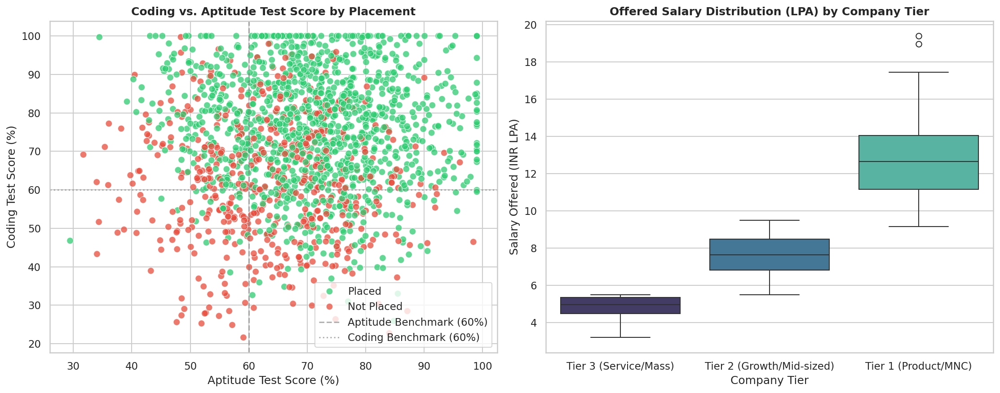

# 🎓 Campus Placement Predictor

<p align="center">
  
  
  
  
  
  
</p>

<p align="center">
  <b><a href="campus-placement-predictor/Campus_Placement_Predictor.ipynb">📓 Open Master Jupyter Notebook</a></b>
</p>

An end-to-end AI/ML predictive analytics system and interactive web application designed to forecast student campus placement outcomes, estimate prospective salary packages, and deliver actionable career recommendations based on academic records, test scores, and behavioral indicators.

---

## 📌 Project Overview

- **Internship:** Lazyskool (YuvaBot Pvt. Ltd.) — 3 Months
- **Development Tool:** Google Antigravity
- **Tech Stack:** Python 3.11, Scikit-Learn, XGBoost, Pandas, NumPy, Plotly, Streamlit, Pytest, Pydantic

### Key Highlights
- **Data Cleaning & Validation:** Enforced strict Pydantic schemas (`StudentProfileSchema`), outlier clipping, and zero-null preprocessing across 1,800 student records.
- **Feature Engineering:** Built composite indicators (*Academic Consistency Index*, *Technical Quotient*, and *Holistic Readiness Score*) inside a leakage-free `ColumnTransformer`.
- **Supervised Modeling:** Benchmarked 4 classifiers via Stratified 5-Fold Cross-Validation, achieving **0.9627 ROC-AUC** and **88.33% Accuracy** on holdout test data, alongside a Random Forest salary regressor (**₹1.41 LPA MAE**).
- **Interactive Dashboard:** 4-tab Streamlit app featuring live placement probability gauges, cohort analytics, and career intervention guidance.

---

## 📊 Model Benchmark Comparison

| Model Architecture | 5-Fold CV ROC-AUC | CV Accuracy | CV F1-Score | Holdout ROC-AUC | Holdout Accuracy | Status |
|:---|:---:|:---:|:---:|:---:|:---:|:---:|
| **Logistic Regression** | **0.9562** | **88.33%** | **0.9135** | **0.9627** | **88.33%** | **Champion Model** |
| **XGBoost Classifier** | 0.9431 | 86.46% | 0.9037 | 0.9510 | 87.22% | Evaluated |
| **Random Forest** | 0.9426 | 87.22% | 0.9074 | 0.9485 | 86.94% | Evaluated |
| **Gradient Boosting** | 0.9403 | 86.74% | 0.9056 | 0.9460 | 86.67% | Evaluated |

---

## 🛠️ Quick Start

```bash
# 1. Clone and enter project directory
git clone https://github.com/<your-username>/campus-placement-predictor.git
cd campus-placement-predictor

# 2. Create virtual environment & install dependencies
python -m venv .venv
.venv\Scripts\activate      # Windows (use `source .venv/bin/activate` on macOS/Linux)
pip install -r requirements.txt

# 3. Launch the Streamlit dashboard
streamlit run src/app.py

# 4. Run unit tests
pytest tests/ -v
```

---

## 📈 Key Visual Insights

<p align="center">
  <strong>Correlation Heatmap</strong><br/>
  
</p>

<br/>

<p align="center">
  <strong>Coding vs. Aptitude &amp; Compensation Tier</strong><br/>
  
</p>

<br/>

<p align="center">
  <strong>Confusion Matrix &amp; ROC Curve</strong><br/>
  
</p>

---

## 📜 License

This project is licensed under the [MIT License](campus-placement-predictor/LICENSE).

---

## 🤝 Acknowledgments

- **Lazyskool (YuvaBot Pvt. Ltd.)** for the 3-month internship opportunity.
- **Google Antigravity** for the AI-powered development workflow.
