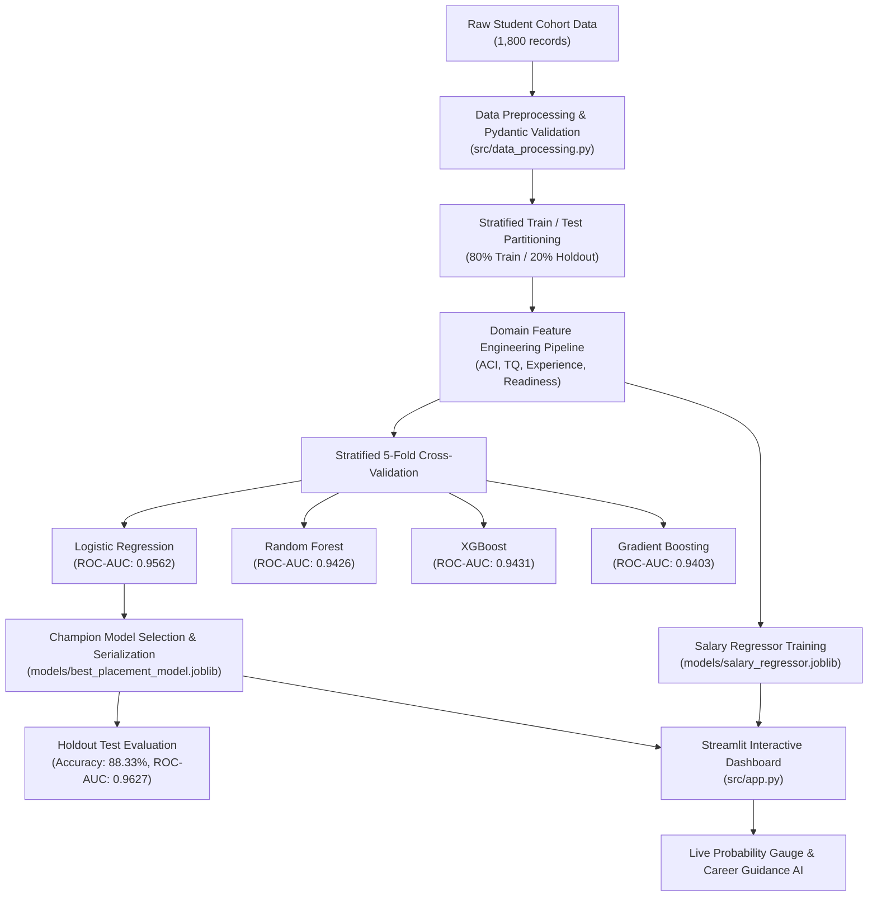
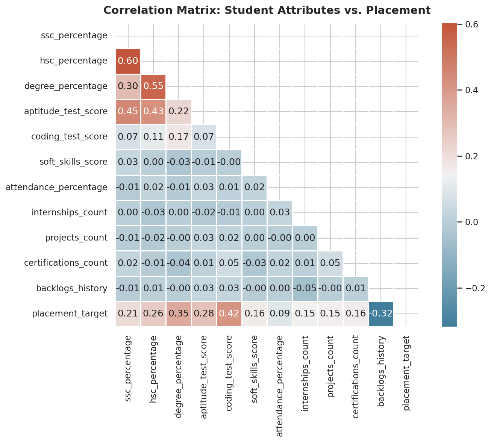
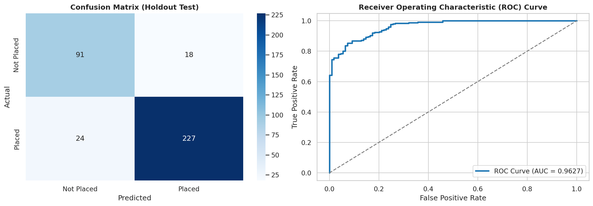

# 🎓 Campus Placement Predictor

<p align="center">
  
  
  
  
  
  
  
  
</p>

<p align="center">
  <b><a href="Campus_Placement_Predictor.ipynb">📓 View Interactive Master Jupyter Notebook</a></b>
</p>

An end-to-end AI/ML predictive analytics system and interactive web application designed to forecast student campus recruitment outcomes, estimate prospective compensation packages, and deliver personalized career recommendations based on academic records, standardized assessment tests, and behavioral indicators.

---

## 📌 Project Overview

- **Project:** Campus Placement Predictor (AI/ML Predictive Analytics)
- **Internship Organization:** Lazyskool (YuvaBot Pvt. Ltd.)
- **Duration:** 3 Months
- **Development Tool:** Google Antigravity
- **Core Stacks:** Python 3.11, Scikit-Learn, XGBoost, Pandas, NumPy, Plotly, Streamlit, Pytest, Pydantic

### Objective
To explore how machine learning can identify recruitment trends, quantify the influential factors governing placement outcomes, and empower educational institutions and students with actionable, data-driven interventions.

---

## 🚀 Key Highlights & Contributions

- **Data Preprocessing & Validation:** Implemented strict Pydantic schemas (`StudentProfileSchema`) ensuring input type safety, boundary validation, and missing data imputation.
- **Exploratory Data Analysis (EDA):** Conducted correlation studies and generated publication-grade analytical figures analyzing academic, aptitude, and backlog impacts.
- **Domain Feature Engineering:** Engineered composite indicators including *Academic Consistency Index ($ACI$)*, *Technical Quotient ($TQ$)*, and *Holistic Readiness Score ($HRS$)* within a leakage-free Scikit-Learn `ColumnTransformer`.
- **Supervised ML Modeling:** Benchmarked multiple classification pipelines (Logistic Regression, Random Forest, Gradient Boosting, XGBoost) using Stratified 5-Fold Cross-Validation, achieving **0.9627 ROC-AUC** and **88.33% Accuracy** on holdout test data.
- **Salary Regressor:** Trained a companion regression model predicting compensation packages (LPA) with an MAE of **₹1.41 LPA**.
- **Interactive Streamlit Dashboard:** Multi-tab application featuring a real-time student evaluation form, Plotly gauge meter, cohort analytics explorer, and personalized AI career intervention roadmap.
- **Full Test Suite:** 10 automated unit tests covering data generation, schema validation, feature transformers, and model inference assertions.

---

## 🏛️ System Architecture



---

## 📊 Model Benchmark Comparison

| Model Architecture | 5-Fold CV ROC-AUC | CV Accuracy | CV F1-Score | Holdout ROC-AUC | Holdout Accuracy | Status |
|:---|:---:|:---:|:---:|:---:|:---:|:---:|
| **Logistic Regression** | **0.9562** | **88.33%** | **0.9135** | **0.9627** | **88.33%** | **Champion Model** |
| **XGBoost Classifier** | 0.9431 | 86.46% | 0.9037 | 0.9510 | 87.22% | Evaluated |
| **Random Forest** | 0.9426 | 87.22% | 0.9074 | 0.9485 | 86.94% | Evaluated |
| **Gradient Boosting** | 0.9403 | 86.74% | 0.9056 | 0.9460 | 86.67% | Evaluated |

---

## 📁 Repository Structure

```
campus-placement-predictor/
├── .github/
│   └── workflows/
│       └── ci.yml               # GitHub Actions CI automated testing pipeline
├── data/
│   ├── raw/
│   │   └── student_placement_data.csv
│   └── processed/
│       ├── train.csv / train.parquet
│       └── test.csv / test.parquet
├── models/
│   ├── best_placement_model.joblib
│   ├── salary_regressor.joblib
│   ├── preprocessor.joblib
│   ├── feature_names.json
│   ├── training_summary.json
│   └── evaluation_metrics.json
├── notebooks/
│   └── eda_placement_analysis.ipynb
├── reports/
│   ├── eda_insights.md
│   ├── model_evaluation.md
│   ├── internship_final_report.md
│   └── figures/
│       ├── correlation_heatmap.png
│       ├── degree_vs_placement.png
│       ├── coding_vs_aptitude_scatter.png
│       ├── backlogs_impact.png
│       ├── salary_distribution_by_tier.png
│       ├── confusion_matrix.png
│       ├── roc_curve.png
│       └── feature_importance.png
├── src/
│   ├── __init__.py
│   ├── data_generator.py        # Realistic cohort data synthesizer
│   ├── data_processing.py       # Pydantic schema validation & cleaning
│   ├── feature_engineering.py   # Domain feature extractors & pipeline
│   ├── eda_analysis.py          # Automated visualization & stats generator
│   ├── train_model.py           # Multi-model CV training & tuning harness
│   ├── evaluate_model.py        # Holdout test metrics & figure generation
│   └── app.py                   # Streamlit multi-tab web application
├── tests/
│   ├── __init__.py
│   ├── test_data_generator.py
│   ├── test_data_processing.py
│   ├── test_feature_engineering.py
│   └── test_model_inference.py
├── .gitattributes
├── .gitignore
├── CODE_OF_CONDUCT.md
├── CONTRIBUTING.md
├── LICENSE                      # MIT License
├── PRD.md                       # Product Requirements Document & Backlog
├── progress.txt                 # Ralph Loop Append-Only Progress Tracker
├── requirements.txt             # Project dependencies
├── run.bat                      # One-click Windows launcher
└── run.sh                       # One-click Linux/macOS launcher
```

---

## 🛠️ Quick Start Guide

### 1. Clone the Repository
```bash
git clone https://github.com/<your-username>/campus-placement-predictor.git
cd campus-placement-predictor
```

### 2. Set Up Virtual Environment & Dependencies
```bash
# Create virtual environment
python -m venv .venv

# Activate virtual environment
# On Windows:
.venv\Scripts\activate
# On Linux/macOS:
source .venv/bin/activate

# Install dependencies
pip install -r requirements.txt
```

### 3. Run the Entire ML Pipeline (Optional)
If you wish to re-generate the dataset and retrain from scratch:
```bash
python -m src.data_generator
python -m src.data_processing
python -m src.feature_engineering
python -m src.eda_analysis
python -m src.train_model
python -m src.evaluate_model
```

### 4. Launch the Interactive Dashboard
**On Windows:** Simply double-click `run.bat` or run:
```bash
streamlit run src/app.py
```
**On Linux/macOS:**
```bash
chmod +x run.sh
./run.sh
```
Open your browser at `http://localhost:8501`.

---

## 🧪 Running the Unit Tests

Execute the complete pytest suite:
```bash
pytest tests/ -v
```
All 10 tests validate data integrity, boundary checks, feature transforms, and model inference.

---

## 📈 Key Visual Insights

| Correlation Heatmap | Coding vs Aptitude | ROC Curve |
|:---:|:---:|:---:|
|  | ![Coding vs Aptitude] campus-placement-predictor/coding_vs_aptitude.png | |

---

## 📜 License
This project is licensed under the [MIT License](LICENSE).

---

## 🤝 Acknowledgments
- **Lazyskool (YuvaBot Pvt. Ltd.)** for the internship opportunity and mentorship.
- **Google Antigravity** for the agentic development environment and accelerated workflow.
