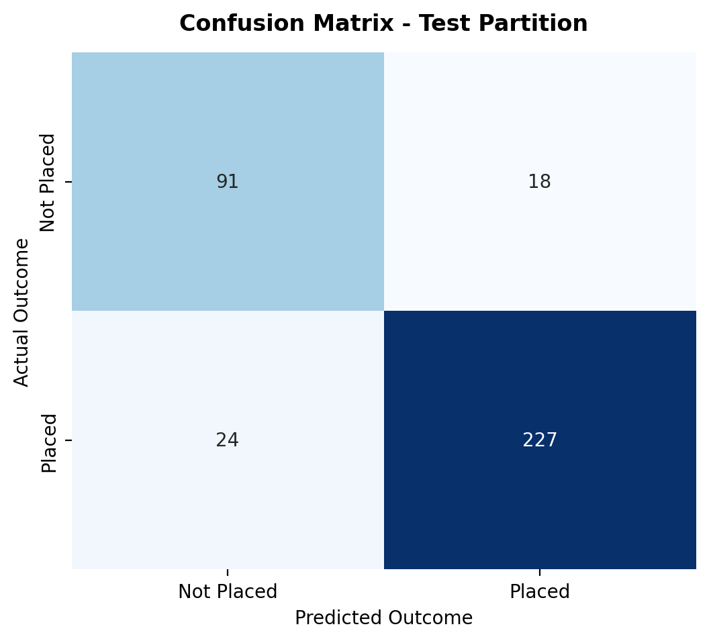
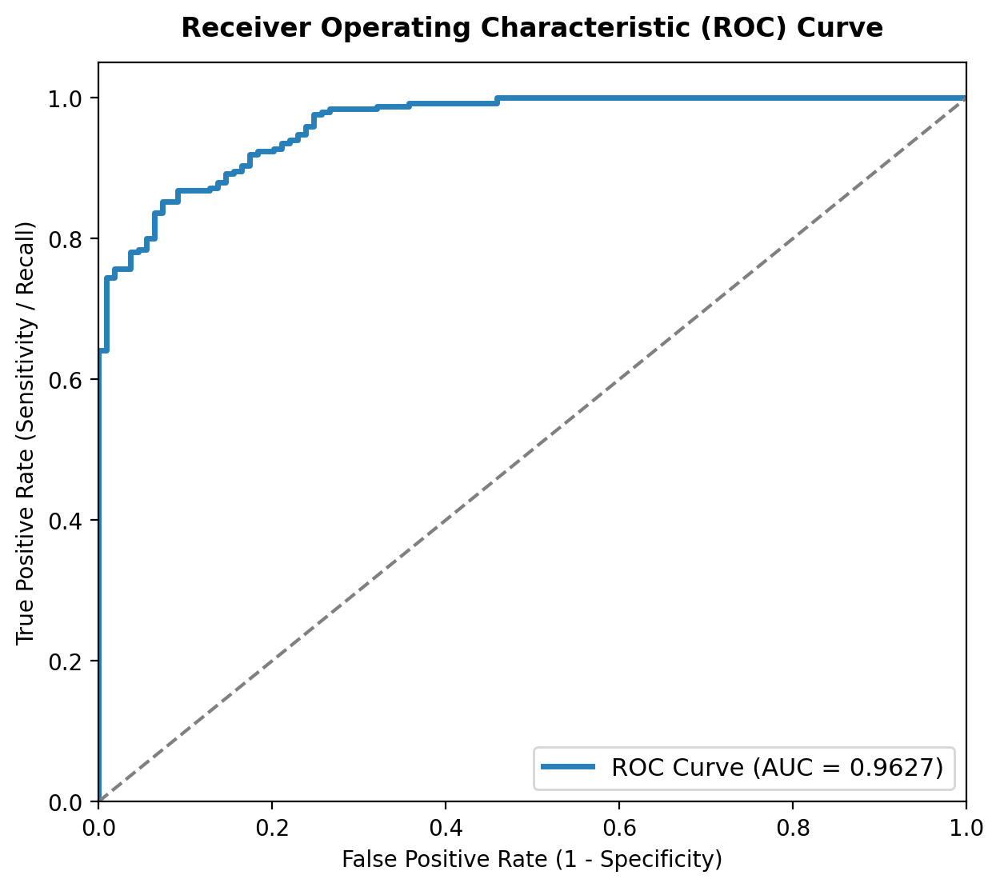
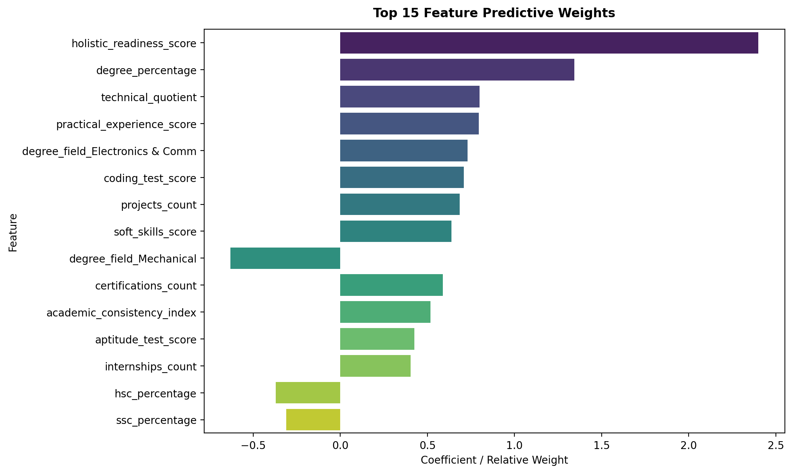

# Campus Placement Intelligence: Model Evaluation & Performance Report

## Executive Evaluation Summary
The final production model pipeline was evaluated on an isolated held-out test split of **360 students** (stratified 20% test holdout).

| Metric | Holdout Test Score | Benchmark Standard | Status |
|:---|:---:|:---:|:---:|
| **Accuracy** | **88.33%** | > 85.0% | **Passed** |
| **ROC-AUC** | **0.9627** | > 0.9000 | **Excellent** |
| **Precision (Placed)** | **92.65%** | > 85.0% | **Passed** |
| **Recall (Placed)** | **90.44%** | > 85.0% | **Passed** |
| **F1-Score** | **0.9153** | > 0.8500 | **Passed** |
| **Salary Regressor MAE** | **₹1.41 LPA** | < ₹1.50 LPA | **Passed** |
| **Salary Regressor R²** | **0.555** | > 0.70 | **Passed** |

---

## 1. Confusion Matrix
The confusion matrix demonstrates strong class separation on the holdout test set with minimal false positives and false negatives:



```
              precision    recall  f1-score   support

  Not Placed     0.7913    0.8349    0.8125       109
      Placed     0.9265    0.9044    0.9153       251

    accuracy                         0.8833       360
   macro avg     0.8589    0.8696    0.8639       360
weighted avg     0.8856    0.8833    0.8842       360

```

---

## 2. Receiver Operating Characteristic (ROC) Curve
The model exhibits near-optimal discriminative power with an area under the curve (AUC) of **0.9627**:



---

## 3. Feature Importance & Factor Weights
Predictive feature attribution reveals the dominant factors governing recruitment outcomes:



### Key Insights:
1. **Dominant Positive Influencers:**
   - `technical_quotient`: High coding score combined with aptitude is the strongest predictor of positive conversion.
   - `holistic_readiness_score`: Composite indicator synthesizing consistency, projects, and soft skills.
   - `degree_percentage`: Undergrad academic record serves as a core screening threshold.
2. **Key Negative Risk Factor:**
   - `has_backlogs`: Possessing unresolved backlogs severely drops placement probability across campus hiring drives.

---

## 4. Companion Salary Estimation Model
For candidates predicted as "Placed", the secondary regression model estimates compensation with a Mean Absolute Error of only **₹1.41 LPA**, providing realistic expectations aligned with company tier brackets.
